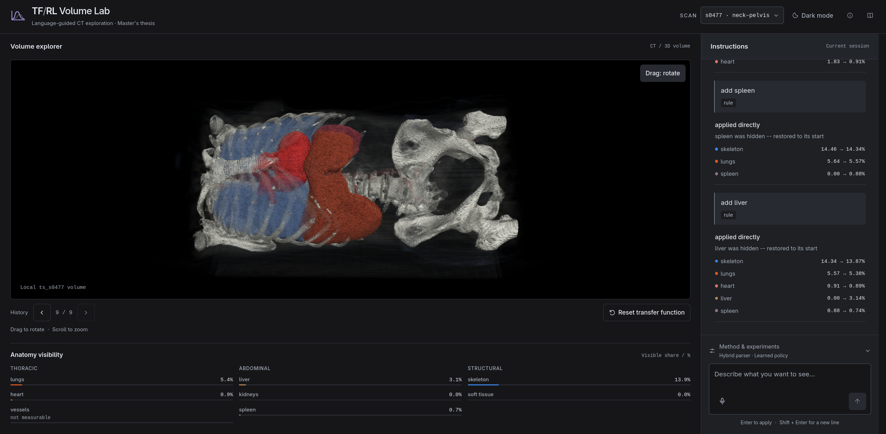
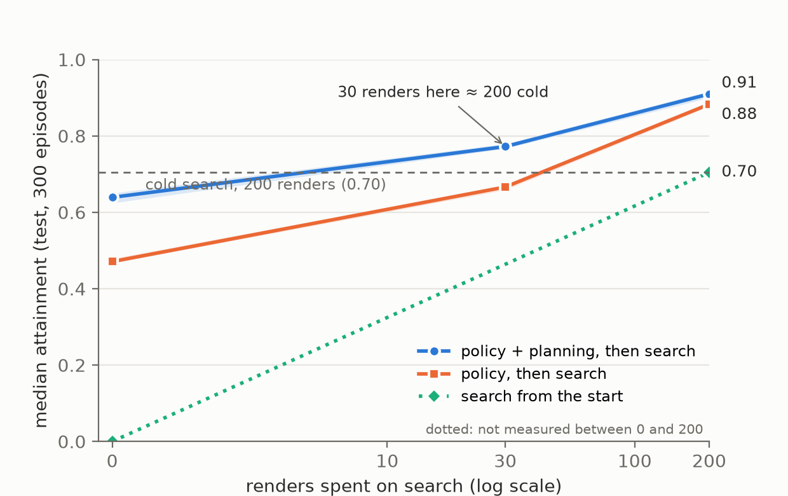

# Say what you want to see

Speak to a CT scan and it renders what you asked for: "show only the
skeleton", "a bit more kidneys", "make the lungs darker". A reinforcement
learning policy turns the instruction into a transfer function, which works on
patients it has never seen. It also works in VR.

<p align="center">
  
</p>

## How it works

1. **Understand.** Whisper transcribes speech. A rule parser handles known
   phrasings, and a local LLM (Ollama) handles everything else.
2. **Propose.** A policy trained with model-based RL suggests a transfer
   function in one step.
3. **Refine.** Gradients through the policy's learned model of the renderer
   improve the suggestion in about 0.2 s, without a single render.
4. **Polish.** A short search on the real objective finishes the job.

On held-out patients, the policy reaches about half of the goal (median
attainment 0.48). Planning raises that to 0.64. With 30 search steps on top it
matches what a search from scratch reaches with 200 (0.77 vs. 0.70), and with
200 it reaches 0.90. Model-free RL (SAC) stayed below 0.1.

<p align="center">
  
</p>

## Quick start

macOS, Ubuntu/Debian, Fedora or Arch. You need `git` and `make`.
For Windows, see [below](#windows).

```bash
git clone https://github.com/kevinkunkel98/reinforcement-learning-volume-rendering-transfer-function.git
cd reinforcement-learning-volume-rendering-transfer-function
make system-deps   # Python 3.12-3.14, OpenGL, mkcert (asks for sudo)
make setup         # Linux without an NVIDIA GPU: make setup CPU=1
make scans         # the 7 demo patients from Zenodo, ~300 MB
make run           # http://127.0.0.1:8000
```

The scan list holds a fixed demo set of seven patients, picked because they
render well (`data/demo_scans.json`). Five of them were never seen in
training, including s0477, the start scan, and s1379, a contrast scan that
shows the vessels. Type a command, or hold Space to talk.

`make scans-candidates` fetches the 24 patients the demo set was picked from
(~1 GB). `make scans-all` fetches all 100 (~3 GB). `make run SCANS=all` lists
every downloaded patient in the viewer.

**Free-form voice commands:** install [Ollama](https://ollama.com/download),
then run `make llm`. Without it, only the rule parser answers.

**VR headset** (tested on a Vive Focus 3) on the same network:

```bash
make certs     # HTTPS certificate for this machine's address
make run-vr    # prints the address to open in the headset browser
```

The headset browser warns once about the certificate. Accept the warning.
Hold the trigger to talk and use the thumbstick to turn the volume.

`make help` lists every target, and `make test` runs the tests (~30 s, on
small synthetic scans, so no download needed).

### Windows

The same steps run in PowerShell through `make.ps1`, which has the same
targets as the Makefile. You need [git](https://git-scm.com/download/win).

```powershell
git clone https://github.com/kevinkunkel98/reinforcement-learning-volume-rendering-transfer-function.git
cd reinforcement-learning-volume-rendering-transfer-function
Set-ExecutionPolicy -Scope CurrentUser RemoteSigned   # once, so .\make.ps1 may run
.\make.ps1 system-deps   # Python 3.13, mkcert, Ollama via winget; then open a new terminal
.\make.ps1 setup
.\make.ps1 scans
.\make.ps1 run           # .\make.ps1 run -Scans all, .\make.ps1 certs, .\make.ps1 run-vr, .\make.ps1 help
```

On Windows, pip installs the CPU build of torch by default, so you don't need
`-Cpu`. For VR, allow Python through the Windows firewall when it asks. You
can also follow the Linux steps in WSL2 (Ubuntu), but a headset can't reach
WSL without port forwarding.

### Without make

```bash
python3 -m venv .venv                          # Python 3.12-3.14
.venv/bin/pip install -r requirements.txt
.venv/bin/python -m tools.fetch_scans --demo --splits   # demo patients
.venv/bin/python server.py                     # http://127.0.0.1:8000
SCANS=all .venv/bin/python server.py           # list every downloaded patient

# VR: certificate for this machine's LAN address, then serve over HTTPS
mkcert -cert-file certs/lan.pem -key-file certs/lan-key.pem <lan-ip> localhost 127.0.0.1
.venv/bin/python server.py --host 0.0.0.0 --ssl-certfile certs/lan.pem --ssl-keyfile certs/lan-key.pem

# voice: local LLM for free-form commands
ollama pull qwen2.5:7b

# tests
.venv/bin/python -m pytest -q
```

`server.py --dataset ts_s0591` starts on another scan. With `--port 8001`
it uses another port.

## Code

| | |
|---|---|
| `server.py`, `session.py`, `answers.py` | the web app; a session and its history; how a command is answered (policy, planning, search, repairs) |
| `commands.py`, `lexicon.py`, `asr.py` | speech, the vocabulary (`data/lexicon.json`), rule and LLM parsing, applying a command |
| `goals.py`, `visibility.py`, `transfer.py`, `render.py` | the task's goals and attainment, the fast visibility estimate, the transfer function, VTK rendering |
| `rl/` | `episodes` (the task), `model_based` + `closed_loop` (training), `evaluate` (the thesis numbers), `search`, `keep_repair`, `colour_guard` |
| `scans.py`, `tools/` | the TotalSegmentator scans and their download; parser and ASR evaluation; headset debugging |
| `static/` | the browser viewer and the VR renderer |

## More

- [`docs/STATUS.md`](docs/STATUS.md): the current state, results and open problems
- [`docs/experiments/`](docs/experiments/): one dated write-up per experiment
  with full tables. The thesis numbers come from `python -m rl.evaluate`;
  retraining runs `docs/experiments/2026-10-19-scripts/pipeline_v3.sh` and
  needs `make scans-all`. Older experiment scripts, SAC and the earlier task
  versions are at tag `pre-refactor-2026-11-08`.
- [`tools/headset/README.md`](tools/headset/README.md): VR URL flags and
  headset debugging

## Data

The CT scans and organ labels come from
[TotalSegmentator](https://zenodo.org/records/10047263) (CC-BY-4.0): 90
training, 4 validation and 6 test patients.
