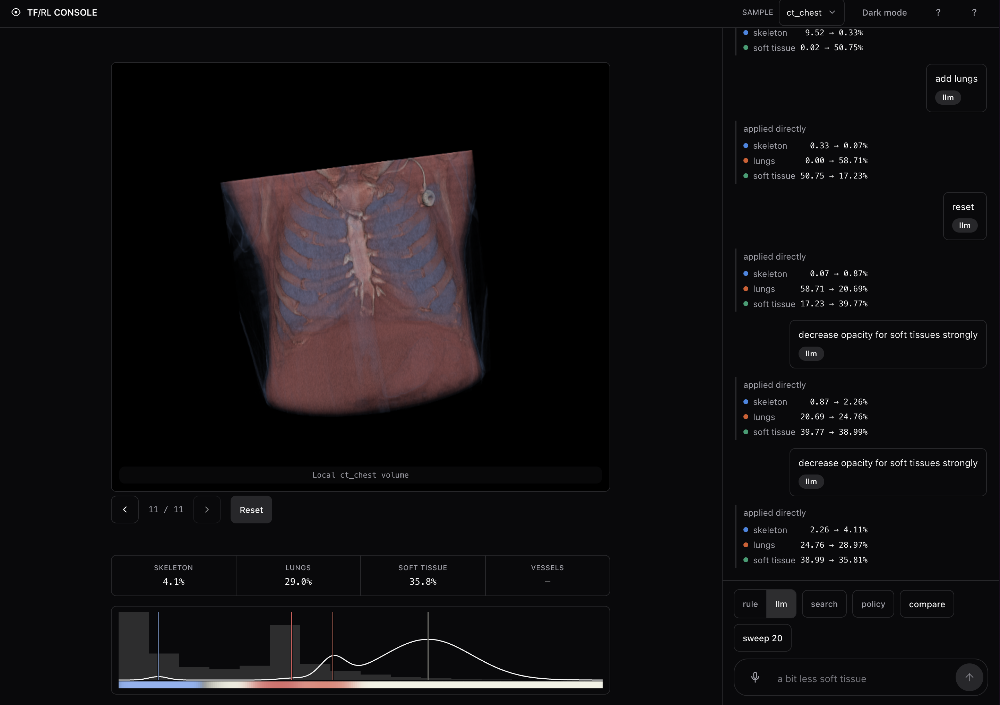

# Say what you want to see

Speak to a CT scan and it renders what you asked for — "show only the
skeleton," "a bit more kidneys." A rule parser or a local LLM turns the words
into an instruction, a policy trained with reinforcement learning proposes the
transfer function in one forward pass, and a short search polishes it.

<p align="center">
  
</p>

This is a master's thesis: can a transfer function be learned with RL well
enough to follow instructions on a patient it has never seen? On six held-out
patients the policy alone gets half-way to the goal of a typical instruction
in one step, and as the starting point of a search it beats the same search
from scratch at every budget.

## Try it

```bash
python server.py      # http://127.0.0.1:8000
```

Type or hold Space to talk. The viewer opens on a transfer function with the
organs in view; every command is answered by the policy plus a 200-evaluation
search (~5 s). Exact application of the parsed command and plain search are
one click away. **compare** answers one instruction four ways from the same
start — applied directly, hill-climbed at 10 and 200 evaluations, and by the
bare policy — with attainment and cost side by side; **sweep 20** does the
same over twenty sampled instructions.

| env var | default | |
|---|---|---|
| `POLICY_PATH` | `out/rl_mb_v2/clb_r3_seed1/checkpoint.pt` | policy checkpoint |
| `POLICY_REFINE_EVALUATIONS` | `200` | search on top of the policy; `30` ≈ 0.70 in ~0.7 s, `0` shows the pure policy |
| `POLICY_STEPS` | `1` | times the policy acts per command (re-rendering in between) |
| `TASK_VERSION` | `v2` | `v1` restores the original start TF and scoring |

The same renderer runs flat in the browser and in a WebXR headset
(`docs/experiments/2026-10-15-vr-lab-session.md`).

## Why this is hard

"More kidneys" has no closed-form answer — it depends on what sits in front
of the kidneys on that particular scan and what else lights up when their
peak moves. Instructions are scored on what the render actually shows:
`visibility.py` estimates each labelled class's visible share of the image
(14 ms against 50–210 ms for a real render), and `goals.py` turns an
instruction into target changes per class and measures **attainment** — 1
means the goal was reached, 0 means no progress, negative means worse than
not touching anything; changing an unmentioned class costs.

Eight classes, all from TotalSegmentator labels: skeleton, lungs, heart,
vessels, liver, kidneys, spleen, soft tissue. The transfer function has one
peak per class, and a labelled voxel is shaded by its own class's peak only
(`transfer_mode="label_scoped"`), so organs that share a Hounsfield range —
soft 40, kidneys 45, heart 50, spleen 55, liver 65 HU — no longer light each
other up. Unlabelled tissue (skin, fat, muscle) still sees peaks by HU.

## The task: v1 and v2

On the original task (v1) about 30 % of instructions could not be improved by
any method, even a 1000-evaluation search. They were ill-posed, not hard:
"less lungs" when the lungs were already invisible, "more spleen" when the
spleen sat behind the skin shell, so revealing it was charged as overshoot
and fading the shell as drift. Task v2 fixes the definition, not the learner:

1. the viewer and training start on a TF with the organs in view;
2. instructions are well-posed (no "less X" for an invisible X);
3. a class hiding a target may fade without penalty (`goals.find_occluders`);
4. targets are clipped to what a class can physically reach.

That lifts what a 500-evaluation search can reach from 0.49 to 0.82. v1 stays
available (`task_version="v1"`); results on the two tasks are reported side
by side, never as one number improving on the other
(`docs/experiments/2026-10-17-task-v2.md`).

## The policy

Model-based RL (`rl/model_based.py`). An ensemble of five MLPs learns what a
transfer-function change does to the measured visibility, from renders of
random changes on 90 training patients. The policy is trained by
backpropagating the exact goal distance through that learned model; Dyna
rounds render the policy's own proposals and refit the model where it was
wrong. A closed-loop fine-tune (`rl/closed_loop.py`) trains through two-step
rollouts, with every instruction kind drawn equally often. Model-free SAC on
the same task stayed at a median of 0.00-0.09.

Task v2, 300 episodes per split, the same episodes for every method, median
attainment; policy rows are three training seeds:

| method | evaluations | val | **test** (run once) |
|---|---|---|---|
| **policy + search** (viewer default) | 200 | 0.89 / 0.89 / 0.89 | **0.90 / 0.91 / 0.90** |
| **policy + search** | 100 | 0.85 / 0.87 / 0.85 | **0.86 / 0.86 / 0.85** |
| **policy + search** | 30 | 0.70 / 0.72 / 0.71 | **0.71 / 0.70 / 0.70** |
| search (hill climb) | 200 | 0.66 | 0.65 |
| **policy alone** | 0 | 0.50 / 0.54 / 0.50 | **0.49 / 0.51 / 0.50** |
| search | 100 | 0.48 | 0.49 |
| search | 30 | 0.13 | 0.14 |
| search | 10 | 0.04 | 0.05 |
| rule executor | 0 | 0.03 | 0.01 |

- The policy alone beats every baseline except the 200-evaluation search
  (paired Wilcoxon p < 1e-15) and generalises: val 0.51, test 0.50.
- As a starting point it beats search from scratch at every budget
  (p < 1e-15). Policy + 30 evaluations is level with a 200-evaluation search;
  with 100 it is clearly ahead.

By kind (test, seed 1):

| kind | policy | + 30 | + 200 | search 200 |
|---|---|---|---|---|
| absolute ("high opacity vessels") | 0.62 | 0.78 | 0.96 | 0.71 |
| relative ("more liver") | 0.53 | 0.76 | 0.97 | 0.74 |
| compound ("more bone, less lungs") | 0.43 | 0.63 | 0.82 | 0.65 |
| show only | 0.40 | 0.53 | 0.70 | 0.35 |
| brightness | 0.79 | 0.89 | 0.93 | 0.99 |

On v1 the same learner reaches 0.23, against at most 0.09 for SAC
(`docs/experiments/2026-10-16-overnight-results.md`).

## What didn't work

- **Model-free SAC** (experiments E1–E9) — a median of at most 0.09 however the
  reward, pretraining or show-only weighting was set. Its critic had to learn
  instruction × rendering physics from one scalar.
- **Behaviour cloning on search results** — negative even as the imitation
  loss improved: averaging several good answers gives a bad one.
- **A ten-step formulation**, nudging parameters over ten steps — never
  learned. Letting the trained policy act twice with a re-render in between
  is no better than once either (p = 0.37).
- **More Dyna rounds** — the fourth added nothing.
- **Intensity-band tissue labels** ("fat", "spongy") — needed real anatomy
  labels. **Measuring visibility by deleting voxels** opens a hole that
  reveals what is behind; blacking out colour, not opacity, is correct.

## Learning from people

A search needs tens to hundreds of renders per instruction, which no one will
rate; a policy answers in one, which makes learning from human preference
feasible. `/collect` shows two candidate renders per instruction, judged blind
(A, B, equal, skip); `tools.merge_preferences` merges several raters' files
and reports their agreement — the ceiling for any reward model trained on
them. Judgments collected before a rendering fix are kept apart as a pilot.

## Data

TotalSegmentator CT (CC-BY-4.0): 20 train / 4 val / 6 test patients, plus 70
more training patients (`train_extra`) for the model-based learner, and four
Slicer CTs as an out-of-source set. Val and test are the same for every
result.

```bash
curl -L -o data/Totalsegmentator_dataset_small_v201.zip \
  "https://zenodo.org/records/10047263/files/Totalsegmentator_dataset_small_v201.zip?download=1"
python -m tools.select_totalseg
python -m tools.extend_totalseg
python -m tools.build_visibility_cache
python -m tools.build_visibility_cache --splits train_extra
```

## Reproduce the policy

```bash
B="--splits train,train_extra --task-version v2"
python -m rl.model_based collect --out out/rl_mb_v2/data_r0b.npz --starts 3000 --seed-base 7000000 $B
python -m rl.model_based train --data out/rl_mb_v2/data_r0b.npz --out out/rl_mb_v2/r0b_seed0 --task-version v2
# Dyna rounds: render the latest policy's proposals, retrain on everything so far
python -m rl.model_based collect --out out/rl_mb_v2/data_r1.npz --starts 1500 --seed-base 8000000 \
    --policy out/rl_mb_v2/r0b_seed0/checkpoint.pt $B
# ... data_r2 (seed base 9000000, policy r1_seed2), data_r3 (4000000, policy cl2_r2_seed2), then per seed:
D=out/rl_mb_v2/data_r0b.npz,out/rl_mb_v2/data_r1.npz,out/rl_mb_v2/data_r2.npz,out/rl_mb_v2/data_r3.npz
python -m rl.model_based train --data $D --out out/rl_mb_v2/r3_seed1 --seed 1 --task-version v2
python -m rl.closed_loop --init out/rl_mb_v2/r3_seed1/checkpoint.pt --data $D \
    --out out/rl_mb_v2/clb_r3_seed1 --seed 1 --balance-kinds --task-version v2

# official scores (300 fixed episodes; --refine N adds policy + N-evaluation search)
python -m rl.vis_eval --policy out/rl_mb_v2/clb_r3_seed1/checkpoint.pt --split val
```

The per-round seeds, policies and logs are in
`docs/experiments/2026-10-17-task-v2.md`; the probes behind its tables are in
`docs/experiments/2026-10-17-scripts/`.

## Setup

```bash
python3 -m venv .venv && source .venv/bin/activate
python -m pip install -r requirements.txt
python -m pytest -q -m "not slow"
```

Run from the repository root — paths like `out/` and `static/` are relative.
Everything runs on CPU. LLM parsing needs Ollama (`ollama serve && ollama pull
qwen2.5:7b`); without it, commands fall back to the rule parser, which covers
the grammar in `COMMANDS.md` and everyday phrasings ("add bones", "set the
spleen to high", "the aorta is dominating the view, pull it back"). Both are
scored by `eval_parsers.py` (`docs/experiments/2026-10-18-instruction-parser.md`).

## Layout

| Path | What's there |
|---|---|
| `server.py`, `static/` | web UI, voice, WebXR viewer, compare panel, preference collection |
| `commands.py`, `asr.py`, `eval_parsers.py` | instruction parsing, speech, parser evaluation |
| `transfer.py`, `anatomy.py`, `anatomy_layers.py`, `render.py` | transfer functions, classes, rendering |
| `visibility.py`, `goals.py` | what a render shows; instructions, task v1/v2, attainment |
| `rl/model_based.py`, `rl/closed_loop.py` | the policy: dynamics ensemble, training, Dyna, closed-loop fine-tune |
| `rl/vis_eval.py`, `rl/baselines.py` | official evaluation, search and rule baselines |
| `rl/oneshot_env.py`, `rl/oneshot_train.py`, `rl/pretrain.py` | the environment; SAC experiments |
| `policy.py` | checkpoint loading for the viewer |
| `datasets.py`, `totalseg.py`, `tools/` | volumes, splits, labels, caches |
| `docs/experiments/` | one dated write-up per experiment, with scripts |

## Reading further

- `docs/experiments/2026-10-17-task-v2.md` — task v2, the policy, policy + search.
- `docs/experiments/2026-10-16-overnight-results.md` — model-based RL on v1, why SAC stalled.
- `docs/STATUS.md` — project snapshot as of 2026-10-14 (before model-based RL).
- `docs/system-documentation.typ`, `docs/transfer-function.typ` — the system and the transfer function in detail.
