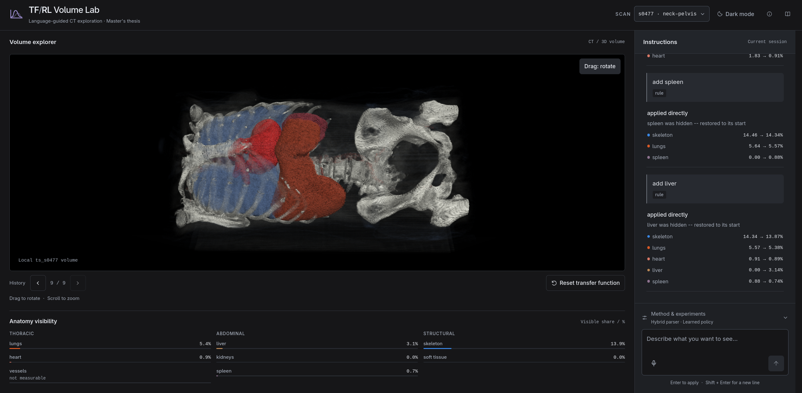
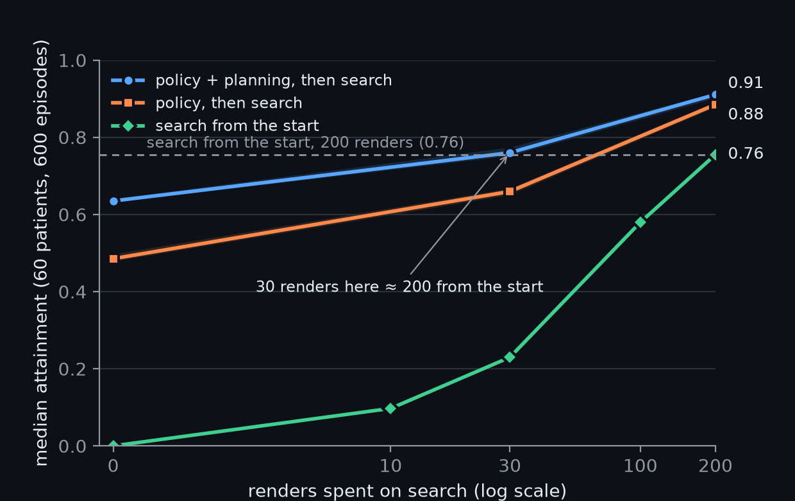
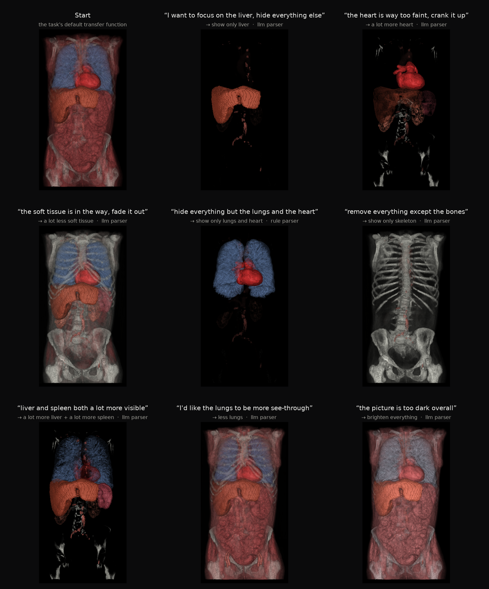
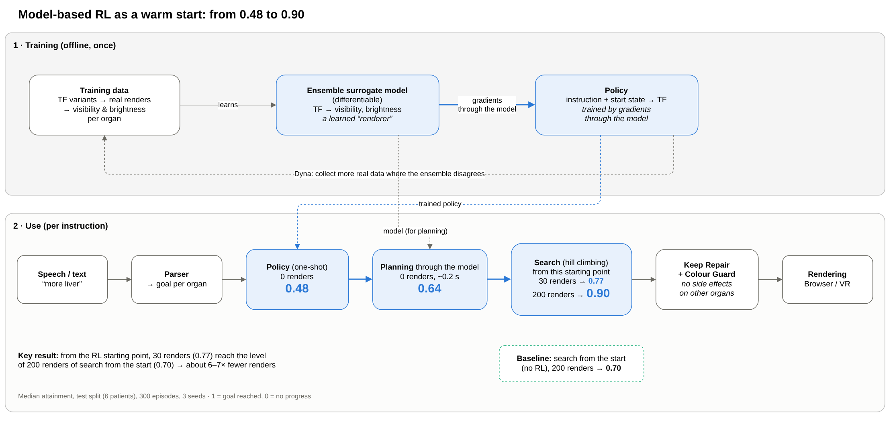

# Say what you want to see

Turning words into a transfer function has so far meant optimising from
scratch for every request, at hundreds of renders each
([Jeong et al.](https://arxiv.org/abs/2406.15634),
[IntuiTF](https://arxiv.org/abs/2506.18407)). This project learns it
once: a policy trained with model-based reinforcement learning answers in a
single forward pass, on patients it has never seen, and a learned model of the
renderer refines that answer without rendering.

Speak to a CT scan and it renders what you asked for: "show only the
skeleton", "a bit more kidneys", "make the lungs darker". Everything runs on
one workstation with a small local language model, by voice, in the browser
and in VR.

<p align="center">
  
</p>

## How it works

1. **Understand.** Whisper transcribes speech. A rule parser handles known
   phrasings, and a local LLM (Ollama) handles everything else.
2. **Propose.** A policy trained with model-based RL suggests a transfer
   function in one step.
3. **Refine.** Gradients through the policy's learned model of the renderer
   improve the suggestion in about 0.2 s, without a single render.
4. **Polish.** A short search on the real objective finishes the job.

On 60 patients never used during development, the policy reaches about half
of the goal (median attainment 0.49). Planning raises that to 0.64. With 30
search steps on top it matches what a search from scratch reaches with 200
(0.76 each; from scratch, 30 steps reach 0.23), and with 200 it reaches 0.91.
Model-free RL (SAC) stayed below 0.1 on an earlier version of the task.

<p align="center">
  
</p>

Each command prints where its time went, in the server console and the
browser console. A policy answer comes in two stages: the first line is the
answer on screen (policy, planning, repairs, one render), the second the
200-render search that replaces it in the background:

```
[latency] #61 policy 'I want to only see bones the heart and the lungs': parse 7 ms (rule) · goal 933 · policy 12 · planning 1636 · repair 42 · render 209 · total 2875 ms
[latency] #61 refined: search 4841 ms · repair 48 · render 274 · end to end 8094 ms
```

This was the first command after a start, which loads models and fills
caches. Repeated, the same sentence takes 0.8 s to the first answer (goal 279,
planning 254 ms). A free-form sentence adds the LLM's 2–3 s to `parse`.

## What you can say

Plain sentences work; there is no command syntax to learn. Name an organ
(skeleton or bones, lungs, heart, liver, kidneys, spleen, vessels, soft
tissue) and say what should happen to it: more or less of it, brighter or
darker, only these, everything but these, or back to the start. Each render
below starts from the same default view and shows how the sentence was
understood. Phrasings the rule parser knows answer at once; the rest go to the
local LLM (about 2–3 s).

<p align="center">
  
</p>

Made by `docs/figures/make_phrasing_gallery.py`.

## Quick start

macOS, Ubuntu/Debian, Fedora or Arch. You need `git` and `make`.
For Windows, see [below](#windows).

```bash
git clone https://github.com/kevinkunkel98/reinforcement-learning-volume-rendering-transfer-function.git
cd reinforcement-learning-volume-rendering-transfer-function
make system-deps   # Python 3.12-3.14, OpenGL, mkcert (asks for sudo)
make setup         # Linux without an NVIDIA GPU: make setup CPU=1
make scans         # the 7 demo patients from Zenodo, ~300 MB
make run           # http://127.0.0.1:8000
```

The scan list shows every downloaded patient, led by a fixed demo set of
seven picked because they render well (`data/demo_scans.json`). Five of them were never seen in
training, including s0477, the start scan, and s1379, a contrast scan that
shows the vessels. Type a command, or hold Space to talk.

`make scans-candidates` fetches the 24 patients the demo set was picked from
(~1 GB), `make scans-all` all 100 (~3 GB). `make run SCANS=demo` lists only the
demo set.

**Free-form voice commands:** run `make llm`. It installs
[Ollama](https://ollama.com) if it is missing (pacman, Homebrew, or the
official script on other Linux distributions; asks for sudo), starts it, and
pulls the model (~5 GB). Without it, only the rule parser answers.

**VR headset** (tested on a Vive Focus 3 and a Vive Focus Vision) on the same
network:

```bash
make run-vr    # prints the address to open in the headset browser
```

The address looks like `https://192-168-1-10.local-ip.sh:8000/`: a public name
for your machine's LAN address with a real certificate from
[local-ip.sh](https://local-ip.sh), so the headset needs no setup. The page
and scans still go directly over your network, but the name lookup needs
internet. The certificate's key is public, so use a network you trust.
Hold the trigger to talk and use the thumbstick to turn the volume.

If the headset can't connect, the network probably keeps devices apart
(campus or hotel Wi-Fi often does). Use a phone hotspot, or connect the headset
by USB and open `http://localhost:8000/` after `make run` and
`adb reverse tcp:8000 tcp:8000`. Offline, `make certs` and `make run-vr
CERT=mkcert` use your own certificate instead. Only the Vive Focus 3 browser
lets you accept it; the Focus Vision browser refuses it.

`make help` lists every target, and `make test` runs the tests (~30 s, on
small synthetic scans, so no download needed).

### Windows

The same steps run in PowerShell through `make.ps1`, which has the same
targets as the Makefile. You need [git](https://git-scm.com/download/win).

```powershell
git clone https://github.com/kevinkunkel98/reinforcement-learning-volume-rendering-transfer-function.git
cd reinforcement-learning-volume-rendering-transfer-function
Set-ExecutionPolicy -Scope CurrentUser RemoteSigned   # once, so .\make.ps1 may run
.\make.ps1 system-deps   # Python 3.13, mkcert, Ollama via winget; then open a new terminal
.\make.ps1 setup
.\make.ps1 scans
.\make.ps1 run           # .\make.ps1 run -Scans demo, .\make.ps1 certs, .\make.ps1 run-vr, .\make.ps1 help
```

On Windows, pip installs the CPU build of torch by default, so you don't need
`-Cpu`. For VR, allow Python through the Windows firewall when it asks. You
can also follow the Linux steps in WSL2 (Ubuntu), but a headset can't reach
WSL without port forwarding.

### Without make

```bash
python3 -m venv .venv                          # Python 3.12-3.14
.venv/bin/pip install -r requirements.txt
.venv/bin/python -m tools.fetch_scans --demo --splits   # demo patients
.venv/bin/python server.py                     # http://127.0.0.1:8000
SCANS=demo .venv/bin/python server.py          # list only the demo patients

# VR: the *.local-ip.sh certificate, then open https://<lan-ip with dashes>.local-ip.sh:8000/
curl -o certs/public.pem https://local-ip.sh/server.pem
curl -o certs/public-key.pem https://local-ip.sh/server.key
.venv/bin/python server.py --host 0.0.0.0 --ssl-certfile certs/public.pem --ssl-keyfile certs/public-key.pem

# voice: local LLM for free-form commands
ollama pull qwen2.5:7b

# tests
.venv/bin/python -m pytest -q
```

`server.py --dataset ts_s0591` starts on another scan. With `--port 8001`
it uses another port.

### Docker

For systems too old for the pinned packages (torch and vtk need glibc 2.28,
so not Ubuntu 18.04) or to keep the system clean. CPU only, rendering in
software. Needs Docker with Compose; on old hosts Docker 20.10.10 or newer.

```bash
mkdir -p out data/totalseg certs
docker compose build
docker compose run --rm viewer python -m tools.fetch_scans --demo --splits
docker compose up -d                                   # http://127.0.0.1:8000
docker compose exec ollama ollama pull qwen2.5:7b      # free-form commands, ~5 GB
```

Scans (`data/totalseg`) and sessions (`out/`) stay on the host. The LLM runs
on the CPU in the container, so free-form commands take several seconds. For VR,
fetch the certificate on the host (`make public-cert`) and run:

```bash
docker compose run --rm -p 8000:8000 viewer python server.py --host 0.0.0.0 \
    --ssl-certfile certs/public.pem --ssl-keyfile certs/public-key.pem
```

## Architecture

Training happens once, offline: an ensemble of networks learns to predict
what the renderer would show, and the policy is trained by gradients through
it. Each instruction then runs policy, planning and a short search.

<p align="center">
  <picture>
    <source media="(prefers-color-scheme: dark)" srcset="docs/figures/pipeline_rl_warmstart.dark.png" />
    
  </picture>
</p>

## Code

| | |
|---|---|
| `server.py`, `session.py`, `answers.py` | the web app; a session and its history; how a command is answered (policy, planning, search, repairs) |
| `commands.py`, `lexicon.py`, `asr.py` | speech, the vocabulary (`data/lexicon.json`), rule and LLM parsing, applying a command |
| `goals.py`, `visibility.py`, `transfer.py`, `render.py` | the task's goals and attainment, the fast visibility estimate, the transfer function, VTK rendering |
| `rl/` | `episodes` (the task), `model_based` + `closed_loop` (training), `evaluate` (the thesis numbers), `search`, `keep_repair`, `colour_guard` |
| `scans.py`, `tools/` | the TotalSegmentator scans and their download; parser and ASR evaluation; headset debugging |
| `static/` | the browser viewer and the VR renderer |

## More

- [`docs/STATUS.md`](docs/STATUS.md): the current state, results and open problems
- [`docs/experiments/`](docs/experiments/): one dated write-up per experiment
  with full tables. The thesis numbers come from `python -m rl.evaluate`;
  retraining runs `docs/experiments/2026-10-19-scripts/pipeline_v3.sh` and
  needs `make scans-all`. Older experiment scripts, SAC and the earlier task
  versions are at tag `pre-refactor-2026-11-08`.
- [`tools/headset/README.md`](tools/headset/README.md): VR URL flags and
  headset debugging

## Data

The CT scans and organ labels come from
[TotalSegmentator](https://zenodo.org/records/10047263) (CC-BY-4.0): 90
training, 4 validation and 6 test patients.
